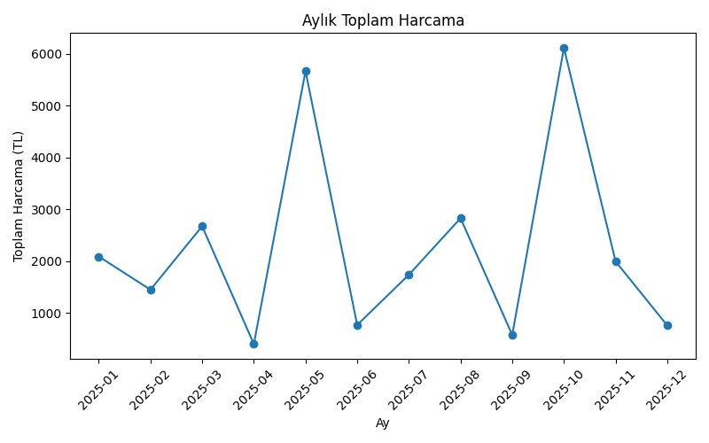

# Simple Data Mining – E-Ticaret Sipariş Analizi

Kişisel e-ticaret siparişleri (Trendyol ve Amazon, 2025) üzerinde temel veri madenciliği tekniklerinin uygulandığı bir ödev projesi.

## İçerik

| Dosya | Açıklama |
|---|---|
| `explore_data.py` | Veriye ilk bakış (ilk satırlar, satır sayısı, platformlar) |
| `association_rules.py` | Ürün bazlı birliktelik kuralları (Apriori) |
| `association_rules_category.py` | Kategori bazlı birliktelik kuralları (Apriori) |
| `clustering.py` | Siparişlerin K-Means ile kümelenmesi (tutar, adet, kategori sayısı) |
| `time_series.py` | Aylık ve platform bazlı harcama zaman serisi grafikleri |
| `orders_anonymized.xlsx` | Anonimleştirilmiş veri seti (70 satır) |

## Veri Seti

Sütunlar: `Platform`, `OrderID`, `OrderDate`, `OrderMonth`, `ProductName`, `ProductCategory`, `Price`, `Quantity`, `TotalAmount`

> **Gizlilik notu:** Veri gerçek siparişlerden oluşmaktadır. Paylaşım için sipariş numaraları sıralı kodlarla (`1001`, `1002`, …), ürün adları ise kategori kodlarıyla (`Kitchen-01`, `Books-03`, …) değiştirilmiştir. Eşleme birebir olduğu için analiz sonuçları orijinal veriyle aynıdır.

## Kurulum ve Çalıştırma

```bash
python -m venv .venv
# Windows
.venv\Scripts\activate
# macOS / Linux
source .venv/bin/activate

pip install -r requirements.txt

python explore_data.py
python association_rules.py
python association_rules_category.py
python clustering.py
python time_series.py
```

## Örnek Çıktı

Aylık toplam harcama:


